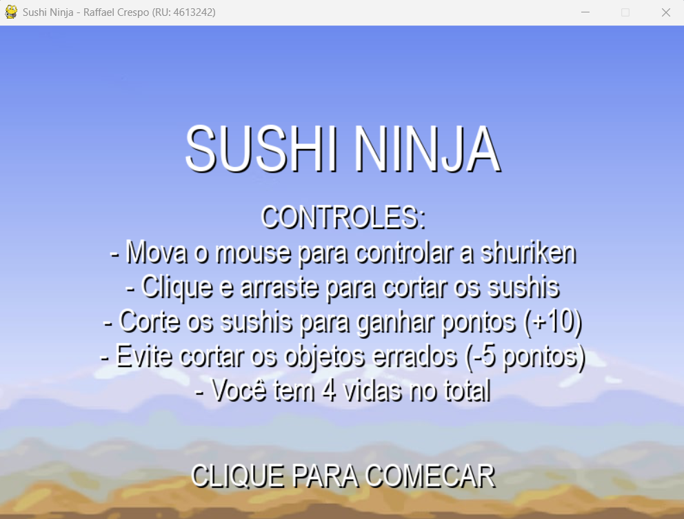
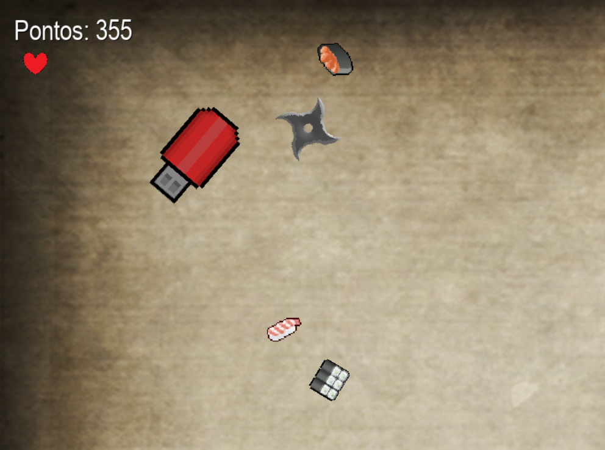
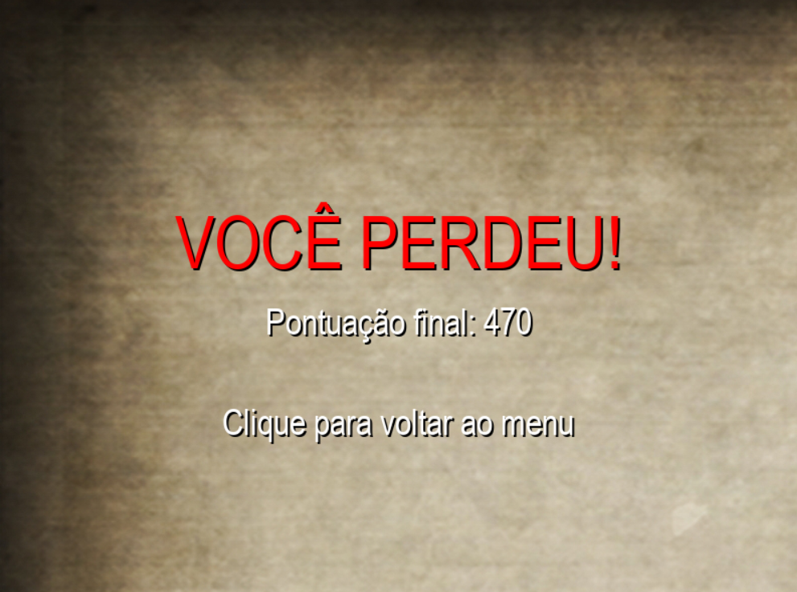

# Sushi Ninja

Jogo 2D desenvolvido em Python com Pygame, inspirado em Fruit Ninja. O jogador controla uma shuriken com o mouse para cortar sushis, acumular pontos e evitar objetos que reduzem a pontuação.

## Demonstração

### Imagens do jogo







### Vídeo

Confira a demonstração da jogabilidade:

[Assistir ao vídeo do Sushi Ninja](videos/sushi-ninja-gameplay.mp4)

## Funcionalidades

- Menu inicial com instruções.
- Movimentação da shuriken pelo mouse.
- Mecânica de corte com clique e arraste.
- Diferentes tipos de sushis e objetos.
- Sistema de pontuação e vidas.
- Efeitos visuais de partículas.
- Efeitos sonoros e música.
- Dificuldade progressiva.
- Tela de Game Over com opção de retornar ao menu.

## Tecnologias utilizadas

- Python
- Pygame

## Como executar

### Pré-requisitos

- Python 3.9 ou superior.

### Instalação

Clone o repositório:

```bash
git clone https://github.com/RaffaelCrespo/sushi-ninja.git
```

Acesse a pasta do projeto:

```bash
cd sushi-ninja
```

Crie um ambiente virtual:

```bash
python -m venv .venv
```

Ative o ambiente virtual no Windows:

```bash
.venv\Scripts\activate
```

Instale as dependências:

```bash
pip install -r requirements.txt
```

Execute o jogo:

```bash
python main.py
```

## Controles

| Ação | Comando |
|---|---|
| Movimentar a shuriken | Mouse |
| Cortar objetos | Clique e arraste |

## Estrutura do projeto

```text
sushi-ninja/
├── assets/
│   ├── img/
│   └── snd/
├── screenshots/
├── videos/
├── main.py
├── main.spec
├── requirements.txt
├── README.md
└── .gitignore
```

## Autor

Desenvolvido por **Raffael Crespo**.